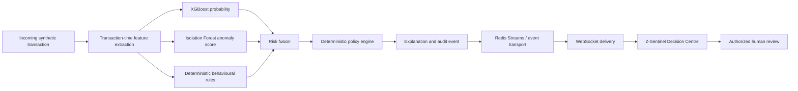

# ArthaMind Z-Sentinel

**Explainable transaction-risk assessment with real-time decisioning and human review.**

ArthaMind is a full-stack banking simulator. **Z-Sentinel** is its transaction-risk decision engine: it evaluates synthetic transaction events, combines machine-learning, anomaly-detection, and deterministic rule signals, then presents a reasoned decision in a live manager interface.

[](LICENSE)


> **Project scope:** Demonstration and engineering prototype using synthetic transaction data. It is not a production fraud-detection service, does not connect to real banking systems, and does not move money.

---

## Contents

- [Overview](#overview)
- [Key capabilities](#key-capabilities)
- [How it works](#how-it-works)
- [Decisioning and explainability](#decisioning-and-explainability)
- [Model methodology and evaluation](#model-methodology-and-evaluation)
- [Technology stack](#technology-stack)
- [Run locally](#run-locally)
- [Demonstration walkthrough](#demonstration-walkthrough)
- [Quality checks and tests](#quality-checks-and-tests)
- [Repository structure](#repository-structure)
- [Limitations and responsible use](#limitations-and-responsible-use)
- [Roadmap](#roadmap)
- [License](#license)

## Overview

Financial-risk signals are difficult to interpret when they are scattered across scores, rules, and event streams. Z-Sentinel brings these signals together in one workflow so a reviewer can inspect the evidence behind a transaction decision and record an informed human override when authorized.

The system is designed to demonstrate the full decision path:

1. Accept a bounded, synthetic transaction scenario.
2. Extract features available at transaction time.
3. Calculate model, anomaly, and deterministic-rule signals.
4. Fuse the signals and apply a deterministic decision policy.
5. Attach a plain-language explanation and audit context.
6. Deliver the result to the browser for inspection and authorized review.

### At a glance

| Area | Implementation |
| --- | --- |
| Primary use case | Explainable transaction-risk triage |
| Data | Reproducibly generated synthetic transactions |
| Risk signals | XGBoost probability, Isolation Forest anomaly score, deterministic rules |
| Decision outputs | `APPROVE`, `STEP_UP_AUTHENTICATION`, `HOLD` |
| Live updates | Redis Streams and WebSocket delivery |
| Human oversight | JWT-authenticated manager access, reasoned overrides, audit events |
| Local inference | Implemented |
| IBM ML for z/OS | Integration boundary only; no live IBM Z deployment is claimed |

## Key capabilities

- **Reproducible scenario simulation** — run normal, high-value outlier, new-device, location-anomaly, velocity-spike, and multi-signal high-risk cases.
- **Multi-signal risk assessment** — combine model probability, anomaly score, and explicit behavioural rules rather than rely on a single threshold or feature.
- **Deterministic policy decisions** — keep the authoritative decision in the policy engine instead of delegating it to a language model.
- **Readable explanations** — use available assessment signals to explain why a transaction received its result, with a deterministic explanation path that does not depend on Gemini.
- **Live decision monitoring** — send completed assessments to the Decision Centre without requiring a browser refresh.
- **Human review and accountability** — protect manager operations with signed JWTs and role-based access control; record overrides with a reason and correlation context.
- **Decision-impact comparison** — compare the relative customer-friction and review-workload assumptions for alternative decisions. These are operational assumptions, not estimates of guaranteed financial savings.
- **Explicit integration boundaries** — the IBM Z provider validates configuration and fails closed when a verified endpoint is not available; it does not fabricate remote inference results.

## How it works

The following diagram summarises the Z-Sentinel decision path.



### Risk fusion

The default fusion weights are:

| Component | Weight |
| --- | ---: |
| XGBoost model probability | 0.50 |
| Isolation Forest anomaly score | 0.30 |
| Deterministic rule signal | 0.20 |

The weighted signals form the fused risk score. The policy engine uses the configured thresholds to classify risk and determine the authoritative action. The interface can present explanations and comparisons, but the language model cannot change the score, confidence, thresholds, or final policy decision.

### Scenario outcomes

The simulator includes a normal baseline and several risk scenarios. A typical demonstration runs a normal event first, then a multi-signal high-risk event so a reviewer can inspect how the assessment changes. The resulting outcome depends on the current assessment and policy configuration; the system should not be interpreted as proof of real-world fraud detection performance.

## Decisioning and explainability

Each assessment can include the model probability, anomaly score, rule signal, fused score, risk level, contributing signals, model version, inference mode, latency, correlation ID, and policy metadata.

The human-review workflow is deliberately separate from automated scoring:

- The policy engine makes the initial decision.
- A reviewer can inspect the assessment and compare alternative actions.
- Privileged overrides require authorization and a reason.
- Review information is recorded for auditability.

Raw device fingerprints are not used as model or UI inputs. Features are intended to be available at transaction time, avoiding the use of future transaction outcomes as inputs.

## Model methodology and evaluation

The local model is an **engineering demonstration model**, not a validated banking fraud model. The reproducible methodology, synthetic-data generation, split design, leakage precautions, and evaluation caveats are documented in [`backend/models/MODEL_METHODOLOGY.md`](backend/models/MODEL_METHODOLOGY.md).

The documented v2.0.0-profiled evaluation at threshold 0.35 reports:

| Synthetic evaluation split | Precision | Recall | F1 | ROC-AUC | PR-AUC |
| --- | ---: | ---: | ---: | ---: | ---: |
| Chronological last-events | 0.2426 | 0.7416 | 0.3657 | 0.8988 | 0.5664 |
| Validation customers | 0.2337 | 0.7907 | 0.3607 | 0.8936 | 0.5103 |
| Test customers | 0.1859 | 0.7463 | 0.2976 | 0.8707 | 0.4461 |
| Weak-combination challenge | 0.1418 | 0.6094 | 0.2301 | 0.8099 | 0.2334 |

These values are **synthetic engineering metrics only**. Precision remains limited, and the values must not be presented as production banking performance. Real-world use would require appropriately governed financial data, rigorous temporal and customer-separated validation, calibration, drift monitoring, operational controls, and independent review.

## Technology stack

| Layer | Technologies |
| --- | --- |
| Frontend | React, TypeScript, Vite |
| API | Python, FastAPI, Pydantic |
| Local ML | XGBoost, scikit-learn, Isolation Forest |
| Risk orchestration | Feature extraction, risk fusion, deterministic policy engine |
| Explanations | Gemini integration with deterministic fallback |
| Event delivery | Redis Streams, WebSockets |
| Persistence | PostgreSQL |
| Retrieval infrastructure | ChromaDB |
| Authentication | Signed JWTs and role-based access control |
| Testing and quality | pytest, Vitest, ESLint, TypeScript, Black, isort, flake8, mypy |
| Environment | Docker Compose, GitHub Actions |

## Run locally

Docker Compose is the recommended way to start the full application and its supporting services.

### Prerequisites

- Docker with the Docker Compose plugin
- Git
- A terminal

For running checks outside Docker, use Python 3.11 and Node.js 20 as configured in the repository's CI workflow.

### 1. Clone the repository

```bash
git clone https://github.com/ESpoorthy/ArthaMind.git
cd ArthaMind
```

### 2. Configure environment variables

```bash
cp .env.example .env
```

Open `.env` and replace the placeholder values before starting the application. In particular:

- Set distinct, randomly generated values for `SECRET_KEY` and `REFRESH_SECRET_KEY` (each must be at least 32 characters).
- Set non-default local passwords for PostgreSQL and Redis.
- Configure `GEMINI_API_KEY` if you want to use the Gemini-powered explanation path.

For a local demonstration without a Gemini API key, set `EXPLANATION_MODE=deterministic` in `.env` to use the deterministic explanation path.

**Never commit `.env` or real credentials.** The repository's `.gitignore` excludes environment files while keeping the example template tracked.

### 3. Start the services

```bash
docker compose up --build
```

Wait for the services to start and report healthy status. The first run may take time while Docker downloads images and builds containers.

| Service | Local URL |
| --- | --- |
| Frontend | [http://localhost:5173](http://localhost:5173) |
| Backend API | [http://localhost:8000](http://localhost:8000) |
| Interactive API documentation (development mode) | [http://localhost:8000/api/docs](http://localhost:8000/api/docs) |

To stop the containers while preserving local volumes:

```bash
docker compose down
```

### Configuration notes

- The default inference provider is local. IBM ML for z/OS settings are only needed when configuring a real, reachable IBM endpoint.
- Docker mode sets `REQUIRE_REAL_INFRASTRUCTURE=true`, preventing Redis from silently falling back to an in-memory event bus.
- Do not expose the development Compose configuration directly to the public internet.

## Demonstration walkthrough

Use a configured manager account in the simulator.

1. Open the manager portal and navigate to the **Z-Sentinel Decision Centre**.
2. Start the bounded simulation with a `NORMAL` scenario and observe the baseline assessment.
3. Run `MULTI_SIGNAL_HIGH_RISK` and inspect the resulting risk score, contributing signals, explanation, and decision.
4. Compare the available decision alternatives in the impact simulator.
5. Confirm the recommended `HOLD` decision, or perform an authorized override to step-up authentication with the required reason.
6. Inspect the audit trail to review the recorded decision and human action.

All demonstration transactions are synthetic. Use the actual result displayed by the running system rather than assuming that every scenario will produce the same score across model or configuration changes.

## Quality checks and tests

The repository includes backend and frontend tests plus CI workflows for linting, typing, building, and infrastructure checks. Run checks in an environment with the required dependencies and services configured.

### Backend

From the repository root:

```bash
cd backend
python -m pip install -r requirements-dev.txt

flake8 src/ tests/ --max-line-length=100 --extend-ignore=E203,W503
black --check src/ tests/
isort --check-only src/ tests/
mypy src/ --ignore-missing-imports
python -m pytest -o addopts='' tests/unit -q
```

The integration tests may require PostgreSQL, Redis, and the test environment variables used by CI. See [the backend CI workflow](.github/workflows/ci.yml) for the authoritative test configuration.

### Frontend and shared package

From the repository root, install the workspace dependencies:

```bash
npm install --legacy-peer-deps
npm run build:shared
```

Then run frontend quality checks:

```bash
cd frontend
npm run lint
npx tsc --noEmit
npx vitest run
npm run build
```

### CI workflows

- [CI — Lint, Test & Build](.github/workflows/ci.yml)
- [Production container image workflow](.github/workflows/deploy.yml)
- [Pull request checks](.github/workflows/pr-checks.yml)

A successful container-image build does not, by itself, prove that a public application deployment is live or healthy.

## Repository structure

```text
ArthaMind/
├── backend/
│   ├── models/                 # Model artifacts and methodology
│   ├── migrations/             # Database schema migrations
│   ├── scripts/                # Evaluation and model utilities
│   ├── src/
│   │   ├── routes/             # FastAPI routes, including Z-Sentinel
│   │   └── sentinel/           # Features, pipeline, policy and audit logic
│   └── tests/                  # Backend unit and integration tests
├── frontend/
│   └── src/
│       ├── pages/              # Customer, agent and manager experiences
│       ├── services/           # API clients
│       └── store/              # Application state and authentication
├── shared/                     # Shared TypeScript package
├── docker/                     # Database initialization and container assets
├── docs/                       # Project documentation
├── .github/workflows/          # CI, PR checks and image workflow
├── docker-compose.yml
├── docker-compose.prod.yml
├── .env.example
├── LICENSE
└── README.md
```

## Limitations and responsible use

- **Synthetic data only:** transactions, labels, and published evaluation values are generated for engineering demonstrations.
- **Not production validated:** the current model has limited precision on the documented synthetic challenge set.
- **No real banking integration:** the project does not access real customer accounts or execute financial transactions.
- **IBM Z is not deployed:** the IBM inference provider is an integration boundary and fails closed without a configured, verified endpoint.
- **Decision comparisons are not financial forecasts:** displayed impact comparisons model operational friction and review workload assumptions.
- **Human oversight remains essential:** actual financial systems require governance, security review, audit controls, and independently validated models.

## Roadmap

- Validate the end-to-end demo across clean local environments.
- Continue improving and independently evaluating model performance on difficult mixed-signal scenarios.
- Strengthen automated integration coverage for streaming, policy decisions, and human overrides.
- Integrate IBM ML for z/OS only when an authorized, reachable environment is available.
- Define production-readiness requirements for data governance, monitoring, access controls, and operational support.

## License

Distributed under the [MIT License](LICENSE).
